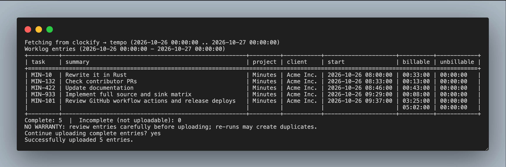

<div align="center">
  <h3 align="center">Minutes</h3>

  <p align="center">
    Sync worklogs between multiple time trackers, invoicing, and bookkeeping software.
    <br />
    <a href="https://gabor-boros.github.io/minutes"><strong>Explore the docs</strong></a>
    <br />
    <br />
    <a href="https://github.com/gabor-boros/minutes/issues/new?assignees=gabor-boros&labels=needs+triage&template=bug_report.md&title=%5BBUG%5D+">Bug report</a>
    ·
    <a href="https://github.com/gabor-boros/minutes/issues/new?assignees=gabor-boros&labels=enhancement&template=feature_request.md&title=%5BREQUEST%5D">Feature request</a>
  </p>
</div>

## About The Project



Minutes is a CLI tool for synchronizing work logs between multiple time trackers, invoicing, and bookkeeping software to make entrepreneurs' daily work easier. Every source and destination comes with their specific flags. Before using any flags, check the related documentation.

Minutes come with absolutely **NO WARRANTY**; before and after synchronizing any logs, please ensure you got the expected result.

Upgrading from 0.3.x? See the [0.3 → 0.4 migration guide](https://gabor-boros.github.io/minutes/migrations/from-0.3-to-0.4/).

## Getting Started

### Prerequisites

Based on the nature of the project, prerequisites depend on what tools you are using. In case you are using Clockify as a time tracker and Tempo as your sync target, you should have an account at Clockify and Jira.

### Installation

#### Using `brew`

```shell
$ brew tap gabor-boros/brew
$ brew install minutes
```

#### Manual install

To install `minutes`, use one of the [release artifacts](https://github.com/gabor-boros/minutes/releases). If you have a Rust toolchain installed, you can build from source as well:

```shell
$ cargo install --path crates/minutes-cli
```

#### Configuration

`minutes` loads configuration from `.minutes.toml` (home directory or OS config dir), then `MINUTES_*` environment variables, then CLI flags. Later layers win.

_To read more about the config file, please refer to the [Documentation](https://gabor-boros.github.io/minutes/configuration)._

## Usage

```plaintext
Fetches worklog entries from a source tracker, shows an overview table, then uploads complete entries to a target tracker.

Config file: .minutes.toml (home directory or OS config dir). Override with --config, MINUTES_* environment variables, or flags. Date formats use chrono strftime (default %Y-%m-%d %H:%M:%S).

Usage: minutes [OPTIONS]

Options:
      --config <PATH>                          Path to a `.minutes.toml` file
  -s, --source <SOURCE>                        Source tracker [clockify|harvest|tempo|timewarrior|toggl]
  -t, --target <TARGET>                        Target tracker [clockify|harvest|tempo|timewarrior|toggl]
      --start <START>                          Inclusive range start (must match `--date-format`)
      --end <END>                              Inclusive range end (must match `--date-format`)
      --date-format <FORMAT>                   Chrono strftime pattern for `--start` / `--end`
      --dry-run                                Fetch and print entries without uploading
      --yes                                    Skip the interactive “Continue?” confirmation
      --force-billed-duration                  Treat total time as billable before upload
      --round-to-closest-minute                Round each entry's duration to the closest minute
      --tags-as-tasks-regex <REGEX>            Regex of tags that should become tasks
      --filter-client <REGEX>                  Regex filter applied to client names after fetch
      --filter-project <REGEX>                 Regex filter applied to project names after fetch
      --table-sort-by <COLUMN>...              Sort overview table by these columns (`-name` for descending)
      --table-hide-column <COLUMN>...          Hide these columns from the overview table
      --clockify-url <URL>                     Clockify API base URL (default `https://api.clockify.me/api/v1/`)
      --clockify-api-key <KEY>                 Clockify API key
      --clockify-workspace <ID>                Clockify workspace ID
      --clockify-user <ID>                     Clockify user ID
      --harvest-access-token <TOKEN>           Harvest personal access token
      --harvest-account <ID>                   Harvest account ID
      --harvest-user <ID>                      Harvest user ID
      --tempo-url <URL>                        Tempo base URL
      --tempo-username <USER>                  Tempo username for Basic Auth
      --tempo-password <PASSWORD>              Tempo password or API token for Basic Auth
      --tempo-worker <WORKER>                  Tempo worker key used on search and create requests
      --timewarrior-command <PROGRAM>          Timewarrior executable (default `timew`)
      --timewarrior-arguments <ARG>...         Extra arguments prepended to every Timewarrior invocation
      --timewarrior-unbillable-tag <TAG>       Tag that marks an interval as non-billable (default `unbillable`)
      --timewarrior-client-tag-regex <REGEX>   Regex matching Timewarrior tags treated as the client
      --timewarrior-project-tag-regex <REGEX>  Regex matching Timewarrior tags treated as the project
      --toggl-url <URL>                        Toggl Track API base URL (default `https://api.track.toggl.com/`)
      --toggl-api-token <TOKEN>                Toggl API token
      --toggl-workspace <ID>                   Toggl workspace ID
      --toggl-user <ID>                        Toggl user ID
  -h, --help                                   Print help
```

### Usage examples

#### Simplest command

```shell
# No arguments, no flags, just running the command
$ minutes
```

#### Preview without uploading

```shell
$ minutes --dry-run
```

#### Non-interactive sync

```shell
$ minutes --yes
```

#### Set specific date and time

```shell
$ minutes --start "2021-10-07 00:00:00" --end "2021-10-07 23:59:59"
```

```shell
$ minutes --date-format "%Y-%m-%d" --start "2021-10-07" --end "2021-10-08"
```

#### Use tags for tasks

```shell
$ minutes --tags-as-tasks-regex '[A-Z]{2,7}-\d{1,6}'
```

#### Minute based rounding

```shell
$ minutes --round-to-closest-minute
```

### Sample config file

```toml
source = "clockify"
target = "tempo"
date-format = "%Y-%m-%d %H:%M:%S"
tags-as-tasks-regex = '[A-Z]{2,7}-\d{1,6}'
round-to-closest-minute = true
force-billed-duration = true

clockify-url = "https://api.clockify.me/api/v1/"
clockify-api-key = "<clockify API token>"
clockify-workspace = "<clockify workspace ID>"
clockify-user = "<clockify user ID>"

tempo-url = "https://<org>.atlassian.net/"
tempo-username = "<jira username>"
tempo-password = "<jira password or API token>"
tempo-worker = "<jira username>"

table-sort-by = ["start", "project", "task", "summary"]
table-hide-column = ["end"]
```

Environment overrides use a `MINUTES_` prefix and underscores (`MINUTES_TOGGL_API_TOKEN`, `MINUTES_SOURCE`, …).

## Supported tools

Every listed **yes** backend can be used as `--source` and/or `--target`. Uploads run with up to five concurrent requests and show a full-width progress bar per entry.

| Tool        | Use as source | Use as target |
| ----------- | ------------- | ------------- |
| Clockify    | **yes**       | **yes**       |
| Everhour    | upon request  | upon request  |
| FreshBooks  | upon request  | **planned**   |
| Harvest     | **yes**       | **yes**       |
| QuickBooks  | upon request  | upon request  |
| Tempo       | **yes**       | **yes**       |
| Time Doctor | upon request  | upon request  |
| TimeCamp    | upon request  | upon request  |
| Timewarrior | **yes**       | **yes**       |
| Toggl Track | **yes**       | **yes**       |
| Zoho Books  | upon request  | **planned**   |

See the [open issues](https://github.com/gabor-boros/minutes/issues) for a full list of proposed features, tools and known issues.

## Unsupported features

The following list of features are not supported at the moment:

- Cost rate sync
- Hourly rate sync
- Estimate sync
- Multiple source and target user support

## Contributing

Contributions are what make the open source community such an amazing place to learn, inspire, and create. Any contributions you make are **greatly appreciated**.

If you have a suggestion that would make this tool better, please fork the repo and create a pull request. You can also simply open an issue.
Don't forget to give the project a star!

1. Fork the Project
2. Create your Feature Branch (`git checkout -b github-username/amazing-feature`)
3. Commit your Changes (`git commit -m 'feat(new tool): add my favorite tool as a source'`)
4. Push to the Branch (`git push origin github-username/amazing-feature`)
5. Open a Pull Request

See [CONTRIBUTING.md](./CONTRIBUTING.md) for local development with mise, pre-commit, and commitlint.
